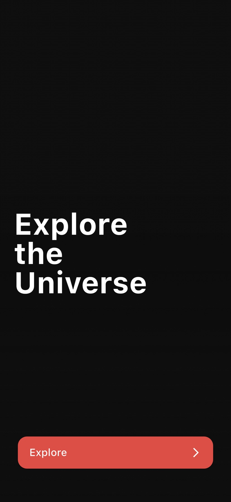
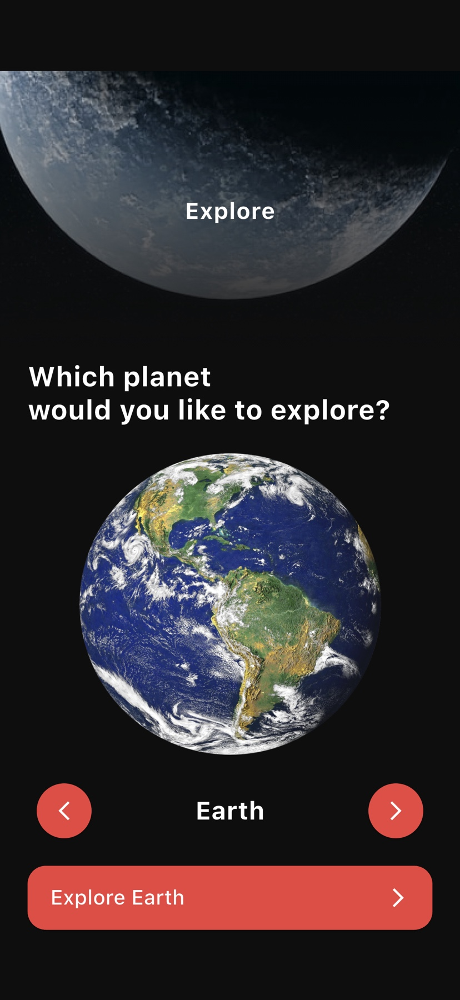
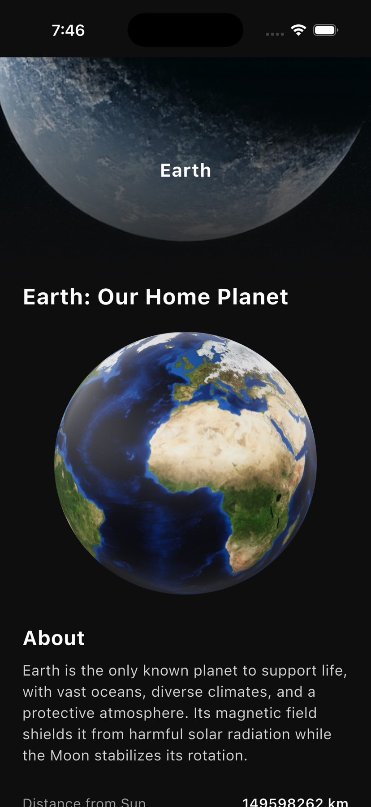
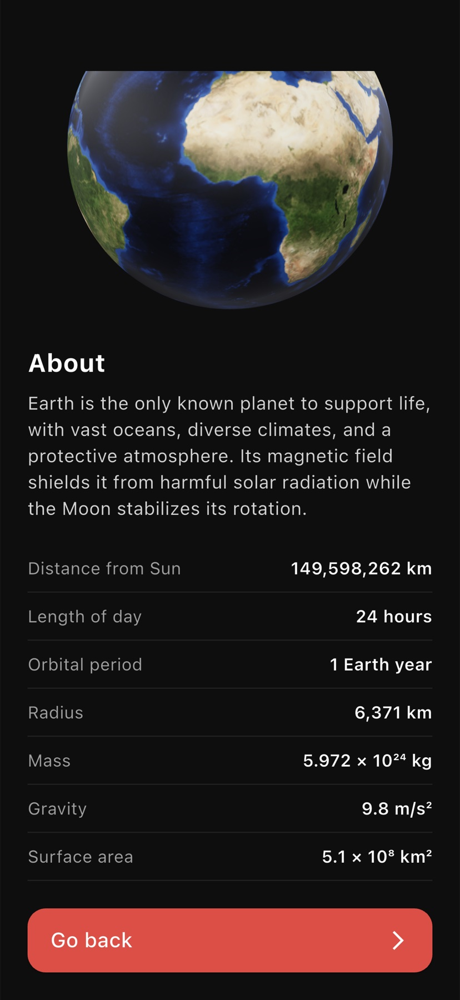

# Space Explorer

An interactive Flutter guide to the Solar System, built around real-time 3D planet models. Swipe or tap through the planets, inspect each world from any angle, and compare key facts at a glance.

<p align="center">
  
  
  
  
</p>

## Highlights

- **Nine explorable bodies** — the Sun, all eight planets, and their orbital order.
- **Interactive 3D** — rotate and pinch each `.glb` model with `flutter_3d_controller`.
- **Fast discovery loop** — swipe the carousel or use the arrow controls to move between worlds.
- **Useful detail view** — descriptions plus distance, day length, orbital period, radius, mass, gravity, and surface area.
- **Responsive layout** — scrollable screens and content widths that adapt from compact phones to tablets.
- **No backend required** — the full experience runs offline from bundled assets.

## Run it

Requires a Flutter SDK with Dart 3.10 or newer.

```bash
flutter pub get
flutter run
```

The bundled assets total roughly 46 MB, including 3D models and planet imagery. An iOS simulator or physical device is recommended for the smoothest 3D performance.

## Verify

```bash
flutter analyze
flutter test
```

The widget and unit tests cover the planet catalog, selector bounds, intro-to-explorer navigation, carousel controls, and compact-screen layout.

Screenshot capture on an iOS simulator:

```bash
flutter drive \
  --driver=test_driver/integration_test.dart \
  --target=integration_test/app_screens_test.dart \
  -d "iPhone 17 Pro"
```

Flutter screenshots cannot capture native platform views, so the 3D detail image was captured directly from the simulator. Generated PNGs are ignored; the curated JPEGs in `screenshots/` are tracked.

## Structure

```text
lib/
├── controller/       # Planet selection state
├── core/             # Theme, colors, routes, asset paths
├── model/            # Planet catalog and facts
├── view/             # Intro, carousel, and detail screens
├── widgets/          # Header, buttons, reusable UI
├── main.dart         # Provider bootstrap
└── space_app.dart    # MaterialApp configuration

integration_test/     # Screenshot walkthrough
test/                 # Unit and widget tests
assets/               # Planet textures, backgrounds, and GLB models
```

The UI is intentionally framework-first: `Provider` owns selection state, routes are centralized in `RoutesManager`, and reusable visual pieces live under `widgets/`.

## Assets

Planet imagery and 3D models are bundled for demonstration. Confirm the license of each third-party asset before redistributing this project or its assets.

---

Built by [AbdQ4](https://github.com/AbdQ4).
